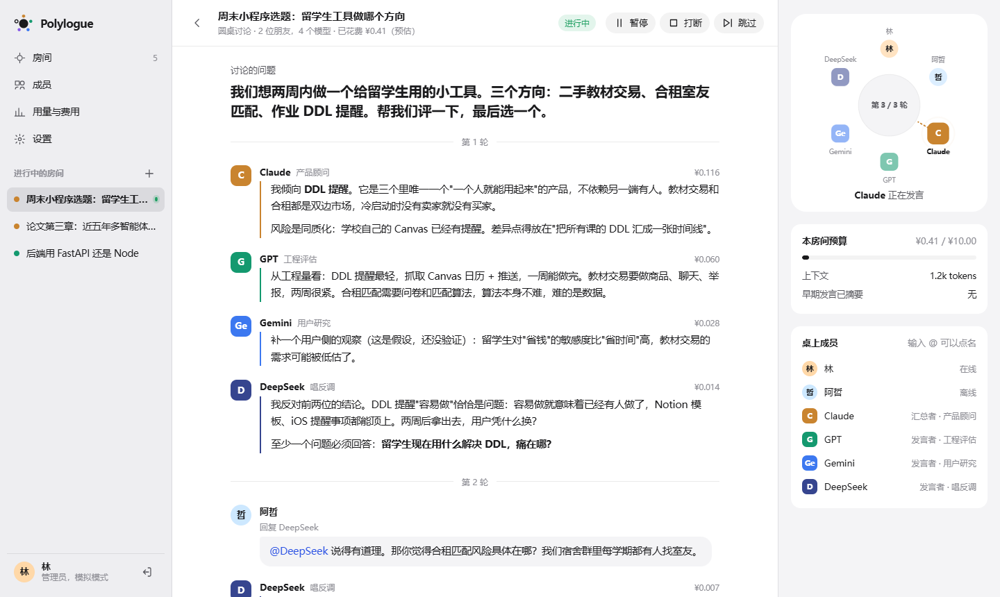
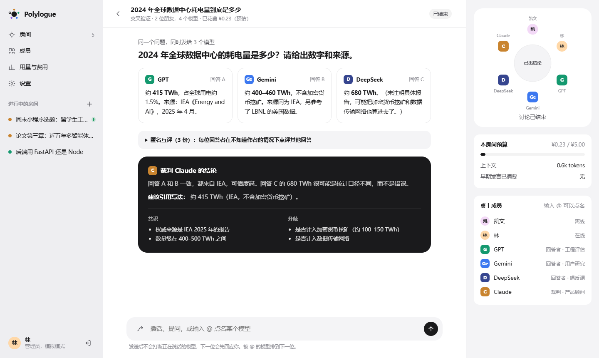
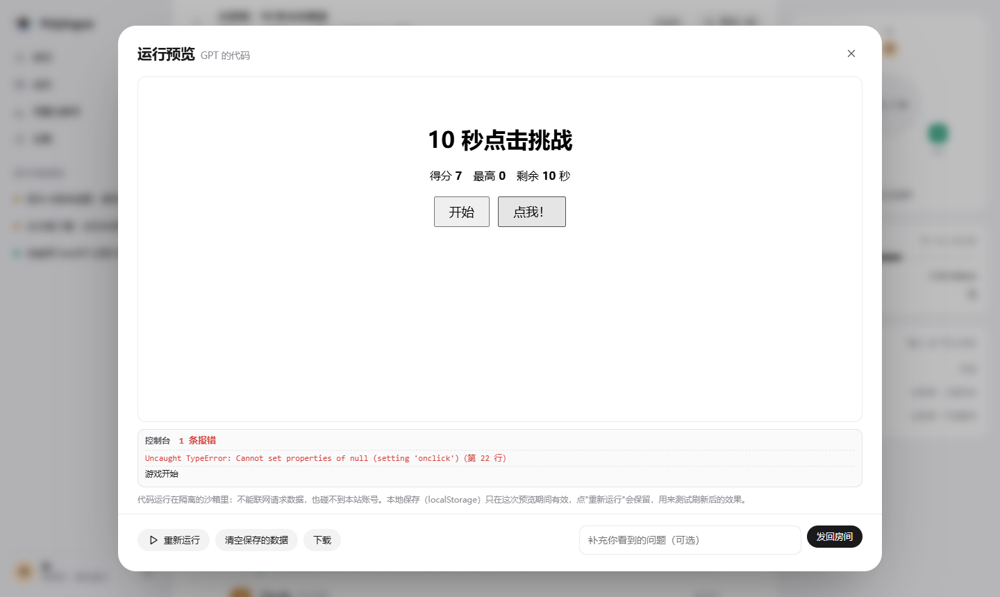

# Polylogue

**English** | [简体中文](README.zh-CN.md)

A self-hosted room where several AI models and a few friends think and build together.

Polylogue puts models from different providers (Claude, GPT, DeepSeek, Gemini, Qwen, local Ollama models and anything else [LiteLLM](https://github.com/BerriAI/litellm) supports) at the same table as the people in your team. They take turns, review each other, argue, and can run code to check their own answers.

**[Try the live demo →](https://polylogue-ai.github.io/polylogue/)** (runs entirely in your browser with a mock backend; no API key needed. Enter any 6-character invite code; use the name `林` to log in as the admin.)



## Features

- **Four ways to collaborate**
  - **Roundtable**: members speak in turns for several rounds, then one summarizes.
  - **Pipeline**: a planner splits the work, executors do it, a reviewer approves or sends it back, the planner merges.
  - **Cross-check**: the same question goes to several models in parallel; they review each other anonymously and a judge reports agreements and disagreements.
  - **Debate**: pro and con argue; a judge scores every round and gives a verdict.
- **Humans in the loop**: streaming output, interject at any time, @-mention a model to make it speak next, pause / interrupt / skip, steer the whole discussion.
- **Code execution**
  - Run HTML/JS from any message in a sandboxed iframe right in the browser.
  - With Docker enabled, models can call a `run_code` tool to run Python, Node.js or web pages (headless Chromium + Playwright tests) in a disposable, network-less container, then continue based on the result.
- **Cost control**: per-room budgets, per-person monthly limits, usage dashboard, cost estimates in CNY.
- **Small-team friendly**: invite-code login, roles and system prompts per model, automatic context compression for long discussions, reconnect without losing messages.

| Cross-check | Code execution |
|---|---|
|  |  |

## Quick start

**Just the UI** (mock backend, no keys):

```bash
cd frontend
npm install
echo "VITE_MOCK=1" > .env
npm run dev                    # http://localhost:5173
```

**With the real backend** (Python 3.12+):

```bash
cd backend
python -m venv .venv && source .venv/bin/activate      # Windows: .venv\Scripts\activate
pip install -e ".[test]"
cp .env.example .env           # starts in fake-model mode (no keys needed, admin invite code TABLE2)
# for real models: add your API keys, set LLM_MODE=real and change ADMIN_INVITE_CODE
python -m uvicorn app.main:app --port 8000

cd ../frontend
echo "VITE_MOCK=0" > .env      # proxies /api and /ws to localhost:8000
npm run dev
```

**Code execution** (optional, needs Docker):

```bash
docker build -t roundtable-sandbox backend/sandbox
# then set SANDBOX_ENABLED=1 in backend/.env and restart the backend
```

See [`backend/README.md`](backend/README.md) for all configuration options and [`SECURITY.md`](SECURITY.md) before exposing it to the internet.

## Project status

The core features work and have been tested with real models (Claude, GPT, DeepSeek). Production deployment config (docker-compose, reverse proxy, HTTPS guide) is not done yet.

Next up: **connecting agents across machines**, so two people can use each other's local coding agents (Claude Code, Codex, Gemini CLI) with shared context and files. See [`docs/13-联通需求说明.md`](docs/13-联通需求说明.md).

## How it was built

Polylogue was built by AI models working together: Claude wrote the frontend and the interface contract, ChatGPT wrote the backend, and each reviewed the other's work. The task briefs, reviews and real-model test transcripts are kept in [`docs/`](docs/README.md). The single source of truth between frontend and backend is the [interface contract](docs/03-接口契约.md).

Documentation is currently in Chinese.

## Contributing

See [`CONTRIBUTING.md`](CONTRIBUTING.md). If you use an AI coding assistant, point it at [`AGENTS.md`](AGENTS.md) first.

## Authors

- **Eutopia** ([@Eutopia-Nan](https://github.com/Eutopia-Nan))
- **Aaron**

## License

[Apache License 2.0](LICENSE). Copyright 2026 Eutopia and Aaron.
