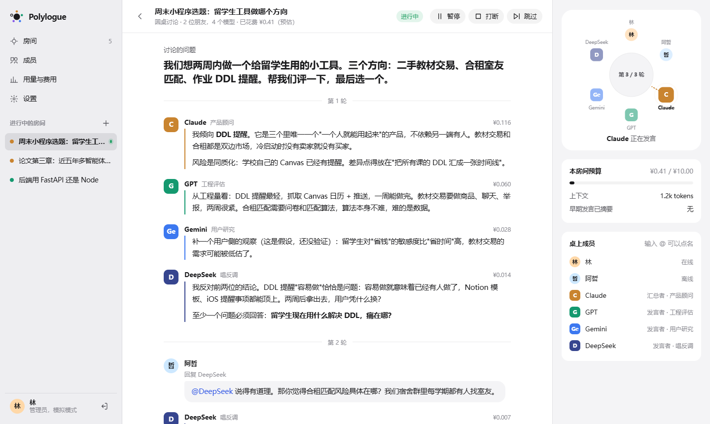
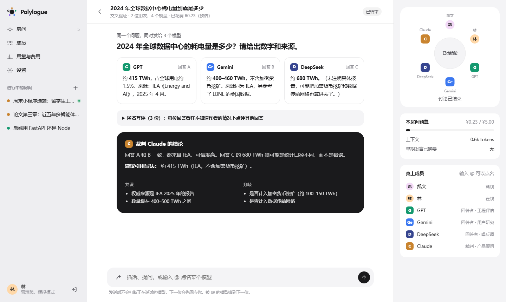
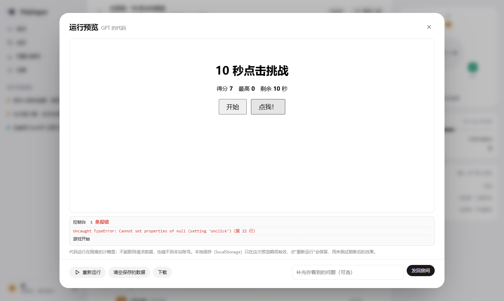

# Polylogue

[English](README.md) | **简体中文**

几个 AI 模型和几个朋友坐在同一个房间里，一起把事情想清楚、做出来。可以自己部署。

Polylogue 让不同厂商的模型和你的团队坐在一张桌子旁：Claude、GPT、DeepSeek、Gemini、通义千问、本地的 Ollama 模型，以及 [LiteLLM](https://github.com/BerriAI/litellm) 支持的任何模型。它们轮流发言、互相审查、辩论，还能运行代码验证自己的答案。

**[在线体验 →](https://polylogue-ai.github.io/Polylogue/)**：全部在浏览器里运行，使用模拟后端，不需要 API Key。输入任意 6 位邀请码，名字填"林"即为管理员。



## 功能

- **四种协作方式**
  - **圆桌讨论**：成员轮流发言若干轮，最后一位汇总。
  - **分工流水线**：规划者拆分任务，执行者完成，审查者通过或退回，规划者汇总。
  - **交叉验证**：同一个问题同时问多个模型，匿名互评，裁判给出共识和分歧。
  - **辩论**：正反方轮流发言，裁判每轮打分，最后裁决。
- **人随时参与**：逐字输出、随时插话、@ 某个模型让它下一个发言、暂停 / 打断 / 跳过、给整场讨论下方向指示。
- **代码运行**
  - 任何一条发言里的 HTML / JS 代码，都可以直接在浏览器的沙箱里运行，报错一键发回房间。
  - 开启 Docker 后，模型可以调用 `run_code` 工具，在一次性、无网络的容器里运行 Python、Node.js 或网页（无头 Chromium + Playwright 测试），看到结果再继续写。
- **费用可控**：房间预算、个人月度上限、用量统计，费用按人民币估算。
- **适合小团队**：邀请码登录，每个模型可以设置角色和提示词，长讨论自动压缩上下文，断线重连不丢消息。

| 交叉验证 | 代码运行 |
|---|---|
|  |  |

## 快速开始

**只看界面**（模拟后端，不需要 Key）：

```bash
cd frontend
npm install
echo "VITE_MOCK=1" > .env
npm run dev                    # http://localhost:5173
```

**连接真实后端**（Python 3.12+）：

```bash
cd backend
python -m venv .venv && source .venv/bin/activate      # Windows：.venv\Scripts\activate
pip install -e ".[test]"
cp .env.example .env           # 默认是假模型模式（不需要 Key，管理员邀请码 TABLE2）
# 用真实模型：填上 API Key，把 LLM_MODE 改成 real，并修改 ADMIN_INVITE_CODE
python -m uvicorn app.main:app --port 8000

cd ../frontend
echo "VITE_MOCK=0" > .env      # 把 /api 和 /ws 代理到 localhost:8000
npm run dev
```

**代码运行**（可选，需要 Docker）：

```bash
docker build -t roundtable-sandbox backend/sandbox
# 然后在 backend/.env 里设置 SANDBOX_ENABLED=1，重启后端
```

全部配置项见 [`backend/README.md`](backend/README.md)。部署到公网前请先读 [`SECURITY.md`](SECURITY.md)。新加入的开发者请读 [`docs/14-交接说明.md`](docs/14-交接说明.md)。

## 项目状态

核心功能已经完成，并用真实模型（Claude、GPT、DeepSeek）测试过。正式部署的配置（docker-compose、反向代理、HTTPS 说明）还没做。

下一步：**联通**。两个人可以互相使用对方电脑上的编程 Agent（Claude Code、Codex、Gemini CLI），共享上下文和文件。见 [`docs/13-联通需求说明.md`](docs/13-联通需求说明.md)。

## 它是怎么做出来的

Polylogue 由 AI 合作开发：Claude 写前端和接口契约，ChatGPT 写后端，两边互相审查。开发过程中实际往来的任务书、审查意见和真实模型测试记录都保留在 [`docs/`](docs/README.md) 里。前后端之间唯一的约定是[接口契约](docs/03-接口契约.md)。

## 参与贡献

见 [`CONTRIBUTING.md`](CONTRIBUTING.md)。如果用 AI 编程助手，先让它读 [`AGENTS.md`](AGENTS.md)。

## 作者

- **Eutopia**（[@Eutopia-Nan](https://github.com/Eutopia-Nan)）
- **Aaron**

## 许可证

[Apache License 2.0](LICENSE)。Copyright 2026 Eutopia and Aaron.
